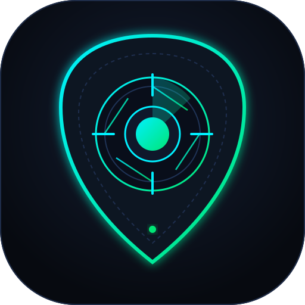

# 🔍 ThreatLens — Hybrid Android Antivirus & Real-Time Shield

<p align="center">
  
</p>

<p align="center">
  <a href="https://github.com/sakinator/ThreatLens/actions/workflows/build-apk.yml"></a>
  <a href="https://opensource.org/licenses/MIT"></a>
  <a href="https://developer.android.com"></a>
  <a href="#zero-idle-battery-performance"></a>
</p>

**ThreatLens** is an open-source, hybrid Android antivirus and active defense shield. It delivers instant, real-time interception of downloaded APKs and files (similar to Kaspersky and Sophos Intercept X) while maintaining **near-zero battery drain** using Linux kernel `inotify` events.

ThreatLens combines **offline on-device heuristics** with **multi-engine cloud intelligence** (VirusTotal, MalwareBazaar, Hybrid Analysis, Kaspersky OpenTIP, MetaDefender Cloud, and Filescan.io) and leverages **free AI APIs (Google Gemini / Groq)** to translate obscure malware detections into plain-English risk advice.

---

## ⚡ Highlights

* **Instant Real-Time Interception**: Intercepts APK downloads immediately upon completion (`CLOSE_WRITE` / `MOVED_TO`) and sideloaded app installations (`ACTION_PACKAGE_ADDED`).
* **Progressive Streaming Results**: Never freezes the UI waiting for slow networks. Emits instant on-device results in `<20ms`, streams cloud engine results as they arrive, and concludes with an AI-generated plain-English risk brief.
* **Zero-Idle Battery Architecture**: Consumes virtually **0.0% CPU** when idle. No polling loops, no timers, and no aggressive wake locks.
* **Hybrid Scoring Engine (0–100)**: Aggregates toxic permission combinations, stealth droppers, and cloud reputation into a balanced score that eliminates false positives.
* **Free AI Threat Explainer**: Uses Google Gemini 1.5/2.0 Flash or Groq to explain what a threat is, what damage it can inflict, and what action to take in plain language.
* **Multi-Cloud Intelligence**: Works with free public API keys from **VirusTotal**, **MalwareBazaar (Abuse.ch)**, **Hybrid Analysis**, **Kaspersky OpenTIP**, **MetaDefender Cloud**, and **Filescan.io**.
* **Modern Cyber UI**: Dark-first Jetpack Compose interface with glowing cyber radar status, live interception stream, visual engine logos, and one-tap quarantine.

---

## 🛡️ Multi-Engine Cloud Matrix

ThreatLens features custom visual badges and direct API drivers for each scanning authority:

| Engine | Emblem | Free API Capability |
| :--- | :---: | :--- |
| **VirusTotal** | 🌐 `VT` | Checks SHA-256 against 70+ antivirus engines simultaneously. |
| **Hybrid Analysis** | 👁️ `HA` | Falcon Sandbox behavioral inspection and threat score (0–100). |
| **Kaspersky OpenTIP** | 🛡️ `K` | Enterprise hash intelligence and threat zones (Red / Yellow / Green). |
| **MetaDefender Cloud** | ⚙️ `MD` | OPSWAT multi-scanning across ~30 commercial AV engines. |
| **MalwareBazaar** | ☣️ `MB` | Abuse.ch community-verified malware signature matches. |
| **Filescan.io** | 📡 `FS` | Deep IOC extraction and sandbox verdicts. |
| **Google Gemini AI** | ✦ `AI` | Free 15 RPM generative threat explanations in plain English. |
| **Groq Cloud** | ⚡ `Groq` | Ultra-fast Llama-3 AI explanations. |

---

## 🚀 Getting Started & GitHub Actions CI

### Push to your GitHub Repository:
Your local repository is already configured with your GitHub remote (`sakinator/ThreatLens`). Push whenever you are ready:

```bash
cd D:\ThreatLens
git push -u origin main
```

### Automated APK Builds with GitHub Actions:
ThreatLens comes pre-configured with `.github/workflows/build-apk.yml`. 
* As soon as you push to GitHub, **GitHub Actions will automatically build the Android APK**.
* You can download the compiled `ThreatLens.apk` directly from your repository's **Actions** tab under **Artifacts**!

---

## 🧪 Testing the Engine (CLI Simulation Tool)

You can test the progressive streaming engine and AI explanation right now on your PC:

```bash
# Test with built-in fallback rules:
python tools/simulate_threatlens_scan.py

# Test with your free Google Gemini API key:
python tools/simulate_threatlens_scan.py "YOUR_GEMINI_API_KEY"
```
