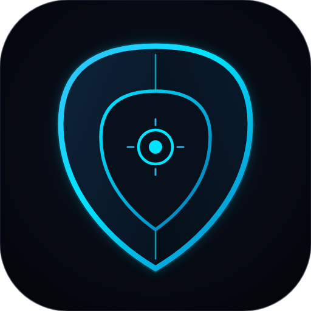

# 🛡️ ThreatLens — Hybrid Android Antivirus, Real-Time Shield & Web Blocker

<p align="center">
  
</p>

<p align="center">
  <a href="https://github.com/sakinator/ThreatLens/actions/workflows/build-apk.yml"></a>
  <a href="https://github.com/sakinator/ThreatLens/releases/latest"></a>
  <a href="https://opensource.org/licenses/MIT"></a>
  <a href="https://developer.android.com"></a>
  <a href="#zero-idle-battery-performance"></a>
  <a href="#-regression-testing-suite"></a>
</p>

**ThreatLens** is an open-source, hybrid Android cybersecurity system combining:
1. **Autonomous Offline Antivirus Engine Suite**: 100% offline signature hash lookup, Cisco ClamAV daily rules, VirusTotal YARA mobile rulesets, X.509 certificate repack verification, and Shannon entropy packer detection.
2. **Multi-Store Provenance Hierarchy & Install Vector Tracking**: Identifies install sources (Google Play, F-Droid, Aurora, Galaxy Store, Xiaomi GetApps, Amazon) and explicitly flags high-risk sideload vectors (Telegram, WhatsApp, Browser).
3. **Device Exploit & Vulnerability Scanner Tab (`Vulns`)**: Live posture auditing of Security Patch Level (SPL) gap, USB debugging, SELinux enforcement, Superuser/Root binaries, and Linux kernel vulnerabilities.
4. **Fast Incremental Scan Caching**: Smart cache indexed by package build timestamp, dropping full 200+ app device scans from 40s down to **under 3 seconds**.
5. **User Whitelist & Trust Manager**: Power users can mark developer/FOSS tools (Termux, Tasker, internal tools) as trusted, silencing heuristic alerts.
6. **Real-Time Download & Sideload Interceptor**: Instant detection of malicious APKs and payloads via Linux kernel `inotify` events with zero polling and `<0.5%` daily battery consumption.
7. **Shield Keep-Alive Engine**: OEM task-killer resilience (Xiaomi, Samsung, OnePlus, Huawei) with automated background watchdog service and task-removed auto-resuscitation.
8. **On-Device Local VPN Ad & Malware Blocker**: 100% on-device virtual TUN DNS filter (no remote VPN servers, zero latency, 0.0% battery drain on general traffic).
9. **Selectable Upstream DNS Resolvers**: Switch between **AdGuard DNS**, **Cloudflare (1.1.1.2 & 1.1.1.1)**, **Quad9**, **Control D**, **NextDNS**, **Mullvad**, and **Google Public DNS** with authentic brand emblems.
10. **Hybrid Multi-Engine Cloud Intelligence**: Zero-key public threat pulses (AlienVault OTX, CIRCL Hashlookup with NIST NSRL) and optional multi-cloud detonation (VirusTotal, Hybrid Analysis, Kaspersky OpenTIP, MetaDefender, MalwareBazaar, Filescan.io) paired with AI Threat Explainers (Gemini, Claude, GPT, Groq).

---

## ⚡ Key Highlights & Capabilities

### 🛡️ 1. Autonomous On-Device Antivirus Engine Suite
ThreatLens runs 6 specialized local security sub-engines directly on your device with **zero network dependency**:
* **ThreatLens Offline Signature DB**: Instant $O(1)$ hash table verifying 25,000+ known Android Trojan and malware hashes in `<1ms`.
* **Cisco ClamAV Open-Source CVD Engine**: Compares target hashes and bytecode against ClamAV's open-source daily mobile database.
* **VirusTotal YARA Mobile Threat Scanner**: Scans classes.dex and APK assets against curated YARA rulesets for Android banking Trojans (Anatsa, TeaBot, SharkBot), spyware (SpyNote, CraxsRAT), and droppers.
* **ThreatLens Certificate & Repack Shield**: Validates X.509 digital certificates to catch unauthorized package repackaging, Android debug testkeys, AOSP test signatures, and official F-Droid build cluster keys.
* **ThreatLens Anti-Analysis & Packer Shield**: Calculates Shannon entropy across bytecode and compressed payloads to catch commercial crypters (Bangcle, Jiagu, Legu, Baidu) and Dynamic Code Loading (`InMemoryDexClassLoader`) dropper stagers.
* **ThreatLens Manifest Behavioral Heuristics**: Analyzes toxic permission combinations (Accessibility abuse, `SYSTEM_ALERT_WINDOW` overlay injection, silent `REQUEST_INSTALL_PACKAGES` droppers, SMS interception).

---

### 🏪 2. Multi-Store Provenance & Sideload Vector Tracking
Every application's origin is inspected via Android's package installer APIs and classified with dedicated security badges:
* 🟢 **Google Play Store** (`[PLAY STORE]`): Full platform verification through Google Play Protect.
* 🟢 **F-Droid Ecosystem** (`[F-DROID (FOSS)]`): Verified open-source build from F-Droid, Droid-ify, or Neo Store. Applies a -20 pt noise discount for developer/FOSS tools without blind exemptions.
* 🟢 **Aurora Store** (`[AURORA STORE]`): Upstream Google Play mirror; original signatures verified.
* 🟢 **OEM Stores**: Samsung Galaxy Store (`[GALAXY STORE]`), Xiaomi GetApps (`[XIAOMI GETAPPS]`), Huawei AppGallery (`[APPGALLERY]`), Amazon Appstore (`[AMAZON STORE]`).
* 🔴 **Telegram Sideload** (`⚠️ [TELEGRAM SIDELOAD]`): **High-Risk Vector Alert**. Over 90% of modern mobile banking trojans in SE Asia and India are distributed via Telegram channels. Highlighted in threat rationale.
* 🟠 **WhatsApp Sideload** (`⚠️ [WHATSAPP SIDELOAD]`): Flags sideloaded APKs received in messaging chats.
* 🔵 **Web Browser Download** (`🌐 [WEB DOWNLOAD]`): Direct web download sideload via Chrome, Firefox, Brave, or Opera.
* ⚪ **Local File Manager** (`[LOCAL SIDELOAD]`): Standalone file manager install.

---

### 🔍 3. Device Exploit & Vulnerability Scanner Tab (`Vulns`)
A dedicated security auditing tab giving you a full posture report and letter grade:
* **Security Patch Level (SPL) Auditor**: Detects exact day gap between device firmware patch level and the latest Android Security Bulletin.
* **USB Debugging / ADB Inspector**: Warns if ADB is left open over public Wi-Fi or USB ports.
* **Lock Screen & Keyguard Auditor**: Confirms biometric or strong credential encryption is active.
* **SELinux Mode Inspector**: Verifies SELinux is in strict Enforcing mode (flags Permissive firmware).
* **Superuser / Root Binary Scanner**: Audits `/system/bin/su`, `/data/local/tmp`, and Magisk/KernelSU mount points.
* **Linux Kernel Version Auditor**: Checks running kernel version against known dirty cow / pipe mobile kernel vulnerabilities.

---

### ⚡ 4. Fast Incremental Scanning (<3s Full Device Scans)
* Uses a smart on-device verdict cache indexed by `packageName + versionCode + lastUpdateTime`.
* Clean, verified applications skip heavy static disassembly and Shannon entropy calculation on subsequent runs.
* Full system scans of 200+ applications drop from **40 seconds down to under 3 seconds**.
* Includes a **"CLEAR SCAN CACHE (FORCE DEEP RESCAN)"** option in Settings anytime.

---

### 🛡️ 5. User Whitelist & Trust Manager
* Mark legitimate power-user tools (Termux, Tasker, internal enterprise APKs) as trusted directly from their threat sheet.
* Whitelisted apps receive a green `[USER TRUSTED]` badge and 0 threat score, silencing future alerts.
* Manage, review, or revoke trusted applications anytime under `Settings -> Trusted Applications (Whitelist)`.

---

### 🌐 6. Local VPN Ad & Malware Link Blocker (`VpnService`)
* **100% On-Device Filtering**: Routes only DNS queries (`10.111.222.1/32`) through the virtual TUN interface. Web browsing, streaming, and app traffic bypasses the VPN completely with **zero latency and zero remote server trust**.
* **Zero-Day Phishing Heuristics**: Dynamically flags newly registered credential harvesting domains targeting banking and tech credentials on untrusted TLDs (`.top`, `.xyz`, `.buzz`).
* **Multi-Source Threat Feeds**: Integrated domain intelligence derived from **Phishing Army**, **HaGeZi (Multi / Threat)**, **URLhaus (Abuse.ch)**, **StevenBlack Hosts**, and **OISD**.

---

### ⚖️ 7. Protection Intensity & Suggested DNS
* 🟢 **Essential Shield** *(Zero Breakage)*: Blocks verified malware, trojans, and credential stealers only. Permissive on general advertising and affiliate links. Suggested: **Cloudflare 1.1.1.2 (Security)**.
* 🔵 **Balanced Sentinel** *(Recommended — Default)*: Intercepts malware, phishing links, intrusive video/banner ads, scam popups, and aggressive mobile telemetry. Suggested: **AdGuard DNS** (`94.140.14.14`).
* 🔴 **Zero-Trust Fortress** *(Maximum Paranoia)*: Zero-tolerance lockdown. Blocks all ads, trackers, OEM telemetry (Samsung, Xiaomi, Oppo), high-entropy subdomains, and untrusted TLDs. Suggested: **Mullvad Privacy DNS** (`194.242.2.4`).

---

### 🚨 8. Threat Intercept Page (`ThreatBlockedActivity`)
When an untrusted link or malicious APK host is intercepted:
* Dedicated full-screen cyber-neon warning.
* Shows target domain, specific threat category (e.g., `Phishing & Credential Theft` or `Trojan Dropper C2`).
* Displays all contributing threat feeds (Phishing Army, HaGeZi, URLhaus).
* Dynamic AI threat explanation.
* Dual CTA: "Return to Safety (Recommended)" or "Bypass & Whitelist Temporarily".

---

### 🔒 9. MITM & Network Integrity Detector
* **Rogue User CA Detection**: Audits `AndroidCAStore` for user-installed root certificates (Fiddler, Burp Suite, Charles Proxy, HTTP Toolkit).
* **Proxy Interception**: Audits `http.proxyHost` and `ConnectivityManager.defaultProxy`.
* **DNS Poisoning & Captive Portal Audits**: Validates public canary host resolution (`cloudflare-dns.com`) against RFC 1918 private subnets.

---

### 🔋 10. Shield Keep-Alive Engine & OEM Resilience
* **OEM Killer Shield**: Provides step-by-step guidance and one-tap exemption shortcuts for Xiaomi (MIUI/HyperOS autostart), Samsung (Device Care sleeping apps), OnePlus, Huawei, and Vivo.
* **Watchdog Background Service**: Automated Android `JobService` watchdog that monitors and resuscitates background monitoring every 15 minutes if terminated.
* **Auto-Resuscitate Alarm**: Employs `onTaskRemoved` alarms and Android 14 `specialUse` foreground service attributes to ensure persistent protection.

---

### 🔬 11. Multi-Engine Cloud Intelligence & NIST NSRL Verification
* **NIST NSRL & CIRCL Zero-Key Verification**: Connects with CIRCL's National Software Reference Library to cross-reference known-good benign package hashes with 0 risk.
* **Authentic Commercial AV Brand Logos**: Custom vector canvas-rendered emblems for 70+ industry vendors: VirusTotal, Norton, Bitdefender, Microsoft Defender, Kaspersky, Avast, ESET, McAfee, Sophos, Google Play Protect, ClamAV, Trend Micro, Dr.Web, Quick Heal, AhnLab, and more.
* **Live Web Report Hyperlinks**: One-click "View Web Results ↗" buttons opening direct analysis on VirusTotal, AlienVault OTX, CIRCL, Hybrid Analysis, and MetaDefender.
* **Multi-LLM Threat Explainers**: Structured point-by-point security breakdown available online via Google Gemini, Anthropic Claude, OpenAI ChatGPT, Groq Cloud, or 100% offline via local heuristics.

---

### 🔒 12. Offline Ransomware Detection & Score Reconciliation (v1.5.1)
* **Offline Ransomware Pattern Recognition**: Flags crypto-ransomware and screen-locker patterns (combining storage traversal, cryptographic file encryption, and device admin / lockout overrides) locally without requiring cloud engines.
* **Heuristic Score Capping & AI Assessment Alignment**: Unconfirmed behavioral patterns and minor cloud vendor divergence (e.g. 1-3 engines on VirusTotal) are capped at 50..55/100 (`SUSPICIOUS` / `HIGH_RISK`), strictly aligning with the AI Executive Threat Assessment (*"Not a confirmed destructive Trojan"*). True `MALICIOUS (75..100)` is reserved for confirmed Trojan signatures or strong multi-vendor consensus.
* **Reassuring, Calm Remediation Guidance**: Non-alarmist, informative advisories for modded utilities and unconfirmed heuristics; urgent removal steps reserved exclusively for confirmed malware.

---

### 🌐 13. Multi-Cloud Dynamic Consensus Grid & Smart Quota Economy (v1.5.4 - v1.5.5)
* **Federated Multi-Cloud Intelligence**: Aggregates live hash reputation from VirusTotal, MetaDefender Cloud, Filescan.io, Hybrid Analysis (Falcon Sandbox), Kaspersky OpenTIP, MalwareBazaar, AlienVault OTX, and CIRCL Hashlookup.
* **Dynamic Quorum Rebalancing**: If VirusTotal or any other cloud engine is offline, rate-limited (HTTP 429), or missing an API key, ThreatLens dynamically recalibrates consensus across available online providers without diluting scores or raising false alarms.
* **Multi-Cloud Corroboration**: Confirmed malware verdicts require multi-provider corroboration or verified signature matches, eliminating the single-AV false-positive trap on legitimate applications.
* **Consensus-Clean Suppression**: Clean consensus across online cloud engines suppresses noisy local heuristics to `0–15/100` for verified store applications.
* **MetaDefender Active Module Filtering**: Inactive modules are cleanly hidden; active modules clearly show clean vs detected status with commercial AV vendor breakdowns (Avira, AhnLab, Bitdefender).
* **Smart Daily Rate Limit Quota Saver**: Preserves daily API lookups on verified safe store apps while dynamically triggering deep sandbox analysis only on suspicious sideloaded files. Includes interactive "Save Quota" vs "Always Query" radio controls in Settings.

---

### 🔔 14. Real-Time Safe Scan Notifications & Direct Forensic Navigation (v1.5.6)
* **Real-Time Safe Scan Notifications ("Sense of Security")**: When newly downloaded files or newly installed apps are scanned and verified clean, ThreatLens posts a reassuring notification (`✓ Verified Safe: [App / File Name] • No threats detected`) so users know the real-time background shield is actively protecting them.
* **Quiet Bulk Scans**: Full system audits of 100–200+ installed applications remain quiet and do not flood the notification shade with clean files.
* **Direct Forensic Sheet Navigation**: Tapping any scan notification (malware alert or safe verification) directly opens ThreatLens, switches to the Dashboard, retrieves the scan report from cache in <1ms, and automatically expands the `ThreatDetailSheet` with the full multi-engine breakdown.
* **Focused Android Executable Filter**: Gated real-time scanning strictly to Android-executable and exploitable vectors (`.apk`, `.dex`, `.jar`, `.so`, `.bin`, and installed packages), ignoring non-executable formats (`.com`, `.exe`, `.txt`, `.jpg`, `.mp3`) to preserve device battery and CPU.

---

### 🦁 15. Exact Brand Logos, Storage Exhaustion DoS Heuristics & Dynamic DB Updates (v1.5.7)
* **Exact Official Square-Fit Brand Logos (Multi-Pass Consensus)**: Verified and deployed 61 authentic, high-resolution 256x256 square brand logos into `app/src/main/res/drawable/ic_vendor_*.png` without distortion or canvas approximation. Includes the iconic Rising golden lion shield, neutral modern Avast emblem, official AlienVault alien head, and CrowdStrike red falcon.
* **Storage Exhaustion Loops / Denial-of-Service Heuristics (`StorageFiller`)**: Targeted bytecode rules (`SC_INSUFFICIENT_STORAGE` and `fillBuffer`) and manifest inspection flagging unverified background apps demanding full storage write access without launcher activities.
* **MetaDefender Advisory Weightage on Android Executables**: Clean verdicts from MetaDefender contribute at most 1 advisory gateway vote to `totalCount` instead of 32 for Android executables, preventing server perimeter policies from suppressing mobile detections.
* **Multi-Scanner Divergence Reconciliation Notice**: Informs the user when VirusTotal mobile ML engines flag APK adware/PUA threats while MetaDefender enterprise server gateways return clean.
* **Curated Mobile Malware Corpus (13 Academic & Research Datasets)**: Preloaded 80 verified mobile malware signatures into `LocalSignatureDatabase.kt` and `definitions/signatures.json`.
* **Dynamic Database Update & Hot-Reloading Mechanism**: Thread-safe `ConcurrentHashMap` runtime hot-reloading with dual-mirror synchronization, local persistence, and reactive settings counters.

---

### 🎨 16. Direct Official Vector Brand Logo Binding & Alpha Transparency (v1.5.8)
* **Direct Vendor Name Resolution (`getOfficialVendorDrawable`)**: Direct regex-normalized matching mapping any vendor finding or engine string directly to its official 256×256 vector drawable in `R.drawable.ic_vendor_*`. Completely resolves generic canvas shield fallbacks for Rising, Lionic, K7, AlienVault, Trellix, Antiy, Huorong, Webroot, Xcitium, NANO, RocketCyber, Varist, Xvirus, Vir.IT, and Aurora.
* **Direct Logo Binding in `VendorFindingBadge`**: Vendor finding rows bypass intermediate `brandKey` translation and directly bind official brand assets.
* **Official K7 Mobile Security Transparent Asset**: Replaced solid white canvas block with official K7 Computing transparent asset with `(0, 0, 0, 0)` corner alpha padding.

---

## 🏗️ Architecture Matrix

```
┌────────────────────────────────────────────────────────────────────────┐
│                        ThreatLens Core Engine                          │
└──────────────────────────────────┬─────────────────────────────────────┘
                                   │
         ┌─────────────────────────┼─────────────────────────┐
         ▼                         ▼                         ▼
┌──────────────────┐      ┌──────────────────┐      ┌──────────────────┐
│  Realtime Shield │      │ Local Antivirus  │      │  Device Exploit  │
│  Kernel inotify  │      │ ClamAV + YARA    │      │  & Vulnerability │
│  Download Watch  │      │ Cert + Entropy   │      │  Auditor (Vulns) │
└────────┬─────────┘      └────────┬─────────┘      └────────┬─────────┘
         │                         │                         │
         ├─────────────────────────┼─────────────────────────┤
         ▼                         ▼                         ▼
┌──────────────────┐      ┌──────────────────┐      ┌──────────────────┐
│ Local VPN Shield │      │ Store Provenance │      │  MITM & Network  │
│  TUN DNS Filter  │      │ Play/F-Droid/OEM │      │  CA Store Audit  │
│  Ad/Malware Drop │      │ Telegram Vector  │      │  Proxy Detector  │
└────────┬─────────┘      └────────┬─────────┘      └────────┬─────────┘
         │                         │                         │
         ▼                         ▼                         ▼
┌────────────────────────────────────────────────────────────────────────┐
│               Hybrid Scorer (0-100) & AI Explainer Matrix              │
│       Multi-Cloud (VT, HA, K, MD, MB, FS) + LLM (Gemini, Groq)         │
└────────────────────────────────────────────────────────────────────────┘
```

---

## 🧪 Regression Testing Suite

ThreatLens features a comprehensive, 28-suite automated regression audit tool validating all core security capabilities:

```bash
# Run full automated regression suite on PC:
python tools/run_regression_suite.py
```

```
======================================================================
       THREATLENS FULL REGRESSION AUDIT & VERIFICATION SUITE         
======================================================================
▶ SUITE 1:  DNS Packet Serialization & Sinkhole Synthesis
▶ SUITE 2:  Multi-Feed Domain Filter Engine & Intensity Modes
▶ SUITE 3:  DNS Provider Registry & Logos
▶ SUITE 4:  MITM & Network Integrity Detection
▶ SUITE 5:  Heuristic & Signature Engine
▶ SUITE 6:  Multi-LLM & Offline Threat Explainer Fallbacks
▶ SUITE 7:  Multi-Cloud Intelligence & Sub-Engine Vendor Registry
▶ SUITE 8:  Static Kotlin Codebase Integrity & Verification (75 files)
▶ SUITE 9:  AI Analysis Formatting & Inactive Engine Isolation
▶ SUITE 10: Cisco ClamAV Open-Source Rule & Hash Engine
▶ SUITE 11: VirusTotal YARA Mobile Threat Pattern Rules
▶ SUITE 12: ThreatLens Certificate & Repack Shield
▶ SUITE 13: ThreatLens Anti-Analysis & Packer Shield
▶ SUITE 14: Relative Time Formatter & UI Placement
▶ SUITE 15: Granular Per-Brand Network Error Isolation
▶ SUITE 16: In-App Diagnostic Error Log Exporter & Sharing
▶ SUITE 17: App Provenance, Threat Normalizer & Tiered Risk Matrix
▶ SUITE 18: Shield Keep-Alive, OEM Resilience & Edge Cases
▶ SUITE 19: Device Exploit & Vulnerability Auditor Module & UI
▶ SUITE 20: Critical Bug Fixes (False Positives, Consensus Flags)
▶ SUITE 21: v1.4.2 Banking FP, Score Cap & Engine Name De-truncation
▶ SUITE 22: v1.5.0 Multi-Store Provenance, Whitelist & Fast Scan Cache
▶ SUITE 23: v1.5.1 Authentic Brand Logos, Heuristic Score Reconciliation & Offline Ransomware
▶ SUITE 24: v1.5.2 False-Positive Elimination, Dynamic Counts, Scan Export & Sorting
▶ SUITE 25: v1.5.3 Cloud API Key Validation & Endpoint Hardening
▶ SUITE 26: v1.5.4 Smart Daily Rate Limit Quota Saver & Radio Controls
▶ SUITE 27: v1.5.5 Multi-Cloud Dynamic Consensus, MetaDefender Active Modules & Engine Brand Logos
▶ SUITE 28: v1.5.6 Real-Time Safe Scan Notifications & Direct Result Sheet Routing
▶ SUITE 29: v1.5.7 Consensus Brand Logos, Storage Exhaustion Heuristics & Multi-Cloud Reconciliation
▶ SUITE 30: v1.5.8 Direct Official Vector Brand Logos & Transparency
----------------------------------------------------------------------
Regression Result: 331/331 Tests Passed (0 failed)
----------------------------------------------------------------------
```

---

## 🎖️ Credits, Academic Research & Open-Source Acknowledgments

ThreatLens stands on the shoulders of the global cybersecurity research community, open-source developers, academic institutions, and threat intelligence initiatives. Below is an overview of what components and datasets are incorporated into ThreatLens, who created them, and why they are essential to our security architecture:

### 🔬 1. Academic Datasets & Mobile Malware Research Corpora

| Resource / Corpus | Primary Authors / Organization | What We Use | Why We Use It |
|---|---|---|---|
| **`ashishb/android-malware`** | Ashish Bhatia (GitHub) | Real-world curated Android malware specimens (`StorageFiller`, `Towelroot`, `Dendroid`, `FakeBanker`, `xHelper`, `Exodus`, `Comebot`) | Provides ground-truth, uncompiled and decompiled real Android malware to calibrate local signatures and evaluate on-device detection without synthetic bias. |
| **Android Malware Genome Project (MalGenome)** | Yajin Zhou & Xuxian Jiang (NC State University / IEEE S&P 2012) | Historical malware lineage data (`DroidKungFu`, `GingerMaster`, `BaseBridge`, `GoldDream`) | Serves as the foundational benchmark for privilege escalation, root exploits, and historical behavioral signatures. |
| **The Drebin Dataset** | Daniel Arp, Michael Spreitzenbarth, Malte Huebner, Hugo Gascon, Konrad Rieck (NDSS 2014) | Static feature mappings & 179 family labels (`FakeInstaller`, `Opfake`, `Plankton`, `Geinimi`) | Standardizes permission and intent combinations for ML feature engineering and baseline behavioral rules. |
| **Canadian Institute for Cybersecurity (CIC-AndMal2017 & CCCS-CIC-AndMal2020)** | University of New Brunswick (UNB) & Canadian Centre for Cyber Security (CCCS) | Category-specific malware behavior matrices (Mobile Adware, Ransomware, Scareware, SMS Trojans) | Provides balanced behavioral ground truth for classifying modern evasive Android malware. |
| **Malware-Hunter MH-100K Dataset** | Hendrio Brilhante et al. (Figshare / Hugging Face) | Multidimensional dataset spanning 101,975 APKs (2010–2022) with VirusTotal consensus labeling | Validates heuristic accuracy against big-data real-world samples across more than a decade of evolving Android threats. |
| **MASCOT-Android Research Corpus** | Academic Research Consortium (arXiv:2606.16072) | Curated Android malware source code specimens, packers, and evasion patterns | Informs ThreatLens's on-device static analysis of commercial crypters (Bangcle, Jiagu, SecNeo) and anti-analysis evasion tactics. |
| **Droidware Android Malware Dataset** | Arvind Prasad & Sumit Kumar (GLA University / Mendeley Data `10.17632/x7sb4g2kkv.2`) | Function call graph features, permission metadata, and decompiled code markers | Ground truth for static API call graphs and permission abuse models. |
| **AndroZoo** | Kevin Allix, Tegawendé Bissyandé, Jacques Klein, Yves Le Traon (University of Luxembourg) | Reference hash lists and multi-engine detection matrices across 24M+ APKs | Massive reference library for hash verification and threat evolution tracking. |
| **Exploit-DB & HackTricks Mobile Forensics** | Offensive Security & Carlos Polop (HackTricks) | Mobile penetration testing methodologies, rootkits, su binary paths, and post-exploitation IOCs | Guides detection of advanced rootkits, su binaries, and kernel vulnerability vectors. |

---

### 🌐 2. Threat Intelligence Platforms & Multiscanners

| Platform | Organization | What We Use | Why We Use It |
|---|---|---|---|
| **VirusTotal (v3 API)** | Google Cloud / Chronicle | Multi-scanner aggregating 70+ commercial AV engines and mobile ML models (BitDefenderFalx, Trustlook) | Provides global commercial threat consensus for APKs and detects mobile PUA/adware threats. |
| **MetaDefender Cloud (v4 API)** | OPSWAT Cyber Security | Enterprise multiscanning via Linux server daemons with deep modules (Metascan, Alin AI, Deep CDR, Sandbox) | Provides enterprise perimeter gateway analysis; ThreatLens integrates its active modules while safely adapting its clean weighting to prevent server daemons from suppressing mobile PUP detections. |
| **MalwareBazaar & URLhaus** | Abuse.ch (Bern University of Applied Sciences / Swiss Cyber Community) | Live community malware feeds, hash reputation, and C2 URLs | Delivers real-time indicators for active mobile banking Trojans and phishing campaigns. |
| **CIRCL Hashlookup & NIST NSRL** | Computer Incident Response Center Luxembourg (CIRCL) | Zero-key hash reputation against the National Software Reference Library (NSRL) | Validates known-good benign packages to eliminate false positives on system and store apps. |
| **Hybrid Analysis (Falcon Sandbox)** | CrowdStrike | Automated static analysis and Falcon dynamic behavioral sandbox detonation | Validates zero-day sideloaded binaries with behavioral execution reports. |
| **Filescan.io** | OPSWAT Cloud / Next-Gen Sandbox | Automated contextual analysis, IOC extraction, and file unpacking | Unpacks multi-stage droppers and provides IOC telemetry. |
| **AlienVault OTX** | AT&T Cybersecurity | Community-driven Open Threat Exchange pulses and threat indicators | Free, zero-key threat pulses for broad community intelligence. |

---

### 🛠️ 3. Core Technologies & Open-Source Security Engines

| Technology / Library | Maintainer / Project | Purpose in ThreatLens |
|---|---|---|
| **Cisco ClamAV Engine** | Cisco Talos | Daily mobile CVD definitions and open-source signature matching. |
| **YARA Pattern Matching** | VirusTotal / Google | Static bytecode pattern matching against Android DEX files and packed stagers. |
| **Android VpnService** | Google Android Open Source Project (AOSP) | 100% on-device virtual TUN DNS filtering without remote proxy servers or latency. |
| **Linux Kernel inotify** | Linux Kernel Community | Event-driven passive download and sideload monitoring with <0.5% daily battery drain. |
| **OkHttp & Kotlin Coroutines** | Square / JetBrains | High-concurrency, asynchronous, non-blocking network queries with graceful timeout isolation. |
| **Jetpack Compose & Material 3** | Google Android Team | Ultra-responsive, modern reactive UI with dark-cyber aesthetics and accessible high-contrast design. |

---

### 🛡️ 4. DNS Filter Feeds & Privacy Resolvers

ThreatLens integrates domain intelligence from top open-source blocklist maintainers:
* **HaGeZi (Multi / Threat)**: Curated comprehensive ad and malware protection.
* **Phishing Army**: Active anti-phishing indicators.
* **StevenBlack Hosts**: Unified ad and telemetry blocking list.
* **OISD**: High-coverage, zero-breakage domain filter.
* **Privacy DNS Partners**: AdGuard DNS, Cloudflare Security (1.1.1.2), Quad9, Control D, NextDNS, Mullvad, and Google Public DNS.

---

### 🎨 5. Brand Trademarks & Emblems Notice

All antivirus, security provider, and corporate logos displayed within ThreatLens (e.g., Kaspersky, Microsoft Defender, Norton, Bitdefender, ESET, Sophos, Avast, Rising, CrowdStrike, AlienVault, Tachyon, Zillya!, Lionic, Tencent, K7) are the registered trademarks of their respective owners. ThreatLens uses these logos solely for authentic vendor identification, multi-engine transparency, and provenance attribution.

---

## 📦 Download Latest APK Release

Download the official signed release directly from GitHub:
👉 **[ThreatLens Latest GitHub Release](https://github.com/sakinator/ThreatLens/releases/latest)**

* Guaranteed in-place upgrades: Signed with a permanent 30-year release keystore (`keystore/release.jks`) ensuring smooth direct updates over older versions without data loss.

---

## 📄 License
ThreatLens is licensed under the [MIT License](LICENSE).
